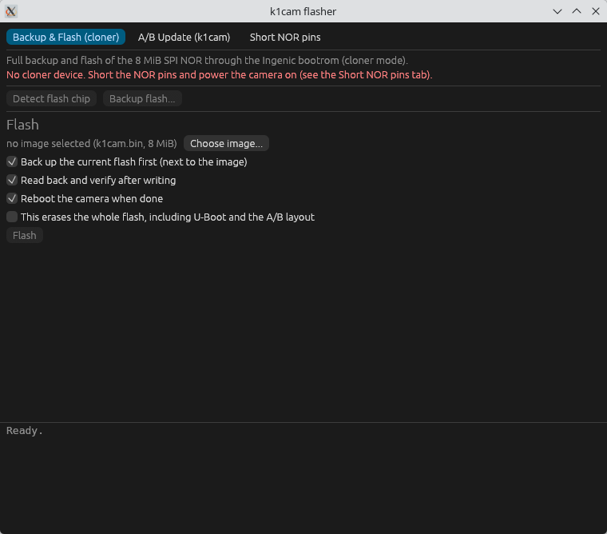
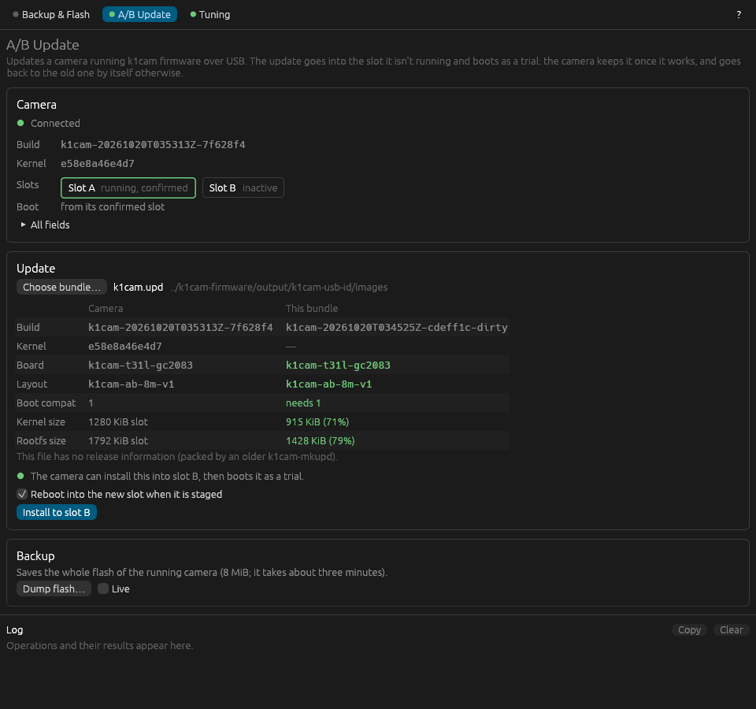
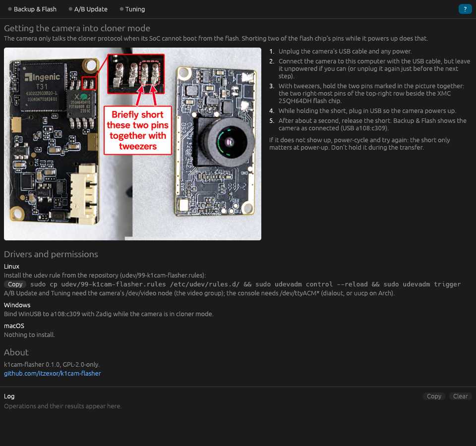
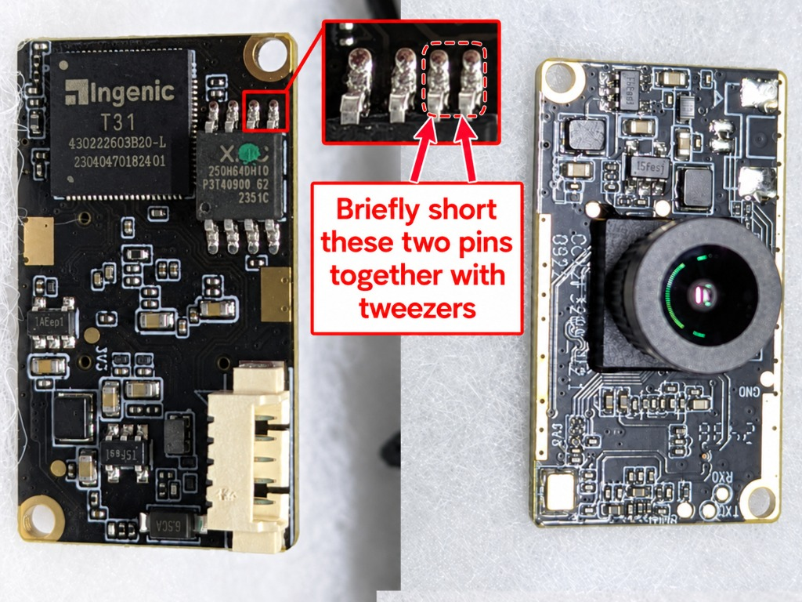

# k1cam-flasher

A small, single-binary GUI to back up, flash and update the Creality K1 camera (Ingenic T31L, 8 MiB SPI NOR) on Linux, Windows and macOS.

- **Backup & Flash (cloner)**: full read and full flash through the Ingenic USB bootrom cloner protocol, ported from [thingino-dfu](https://github.com/gtxaspec/thingino-dfu) (T31 family only), with read-back verification.
- **A/B Update (k1cam)**: dump, update the inactive slot, reboot into the trial or cancel it, over the k1cam UVC extension unit protocol (same as `uvcdctl firmware`). On Linux it uses the uvcvideo XU ioctl on `/dev/videoN` (needs access to the video node, e.g. the `video` group); on macOS it uses libusb (untested). Not available on Windows. `k1cam-flasher --info` prints the camera info on the command line.
- **Short NOR pins**: built-in instructions for forcing cloner mode (see below).

| Backup & Flash | A/B Update | Short NOR pins |
|---|---|---|
|  |  |  |

> Not yet tested against real hardware. Take and check a backup before relying on it.

## Getting the camera into cloner mode

The bootrom only listens on USB when the SoC cannot boot from the NOR, so you short two NOR pins while it powers up.

1. Unplug the camera from power and USB.
2. With tweezers, hold together the two right-most pins of the top-right row of pins beside the XMC 25QH64DH NOR chip (marked in the picture).
3. Keep holding while you plug in USB so the camera powers up.
4. After about a second release the short. `lsusb` shows `a108:c309` and the app shows a green status.

The short only matters at power-up. If the device does not appear, power-cycle and retry. The same text is in the app's *Short NOR pins* tab.

## Driver setup

Running k1cam firmware uses `f055:4b31` (unofficial FOSS community VID,
`4b31` = "K1"), manufacturer `k1cam`, product `K1 Camera`. This is a project
convention, not an exclusive allocation. Earlier `1d6b:0110` firmware is
also recognized so updates and rollback can cross the ID change. The boot
ROM's cloner identity remains `a108:c309`. See the
[firmware USB identity notes](https://github.com/itzexor/k1cam-firmware/blob/k1cam/USB-IDENTITY.md)
for the rationale and collision checks.

- **Linux**: `sudo cp udev/99-k1cam-flasher.rules /etc/udev/rules.d/ && sudo udevadm control --reload && sudo udevadm trigger`
- **Windows**: bind WinUSB to `a108:c309` with [Zadig](https://zadig.akeo.ie/) while the camera is in cloner mode.
- **macOS**: nothing to install.

## Using it

- Backup: *Detect flash chip* checks the link, *Backup flash...* saves the 8 MiB image and shows its SHA-256.
- Flash: choose `k1cam.bin` (exactly 8 MiB), optionally back up first, tick the confirmation, press *Flash*. This replaces U-Boot and installs the A/B layout once. After that, update with `k1cam.upd` on the A/B tab.

## Build

`cargo build --release` (needs a C toolchain; libusb is vendored). On Linux the build needs no extra GUI libraries beyond the usual X11/Wayland ones at runtime. CI in `.github/workflows/build.yml` builds all three OSes.

## Embedded cloner data

`src/cloner/data/` holds the burner SPL and U-Boot (GPL, from thingino-dfu), the T31X DDR config, the SoC-detect MIPS stub, the partition marker and the SPI NOR descriptors, generated byte-exactly with thingino-dfu's own code. Regenerate with `tools/gen-cloner-data/gen.sh /path/to/thingino-dfu-historical`.

## License

Mixed, per file (SPDX identifiers in the sources, texts in `LICENSES/`):

- **MIT**: the GUI, the k1cam A/B protocol client, the bundle parser, udev rule and build files.
- **GPL-2.0-only**: `src/cloner/` and `tools/gen-cloner-data/`, which are derived from [thingino-dfu](https://github.com/gtxaspec/thingino-dfu), and the embedded burner SPL/U-Boot and generated blobs in `src/cloner/data/` (GPL U-Boot, thingino-dfu output).
- **CC0-1.0** (public domain): the photo `docs/short-nor-pins.jpg` and this documentation.

The built binary links the GPL-2.0-only code, so it as a whole is distributed under GPL-2.0-only; the source for it is this repository.
